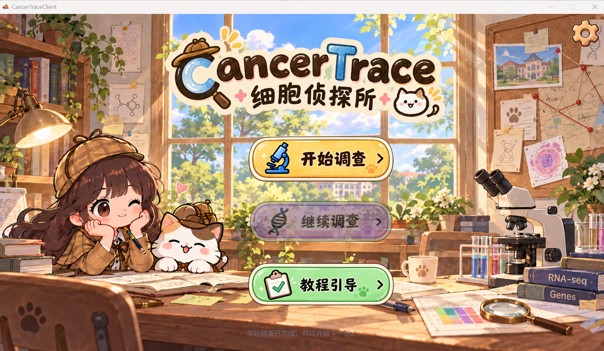
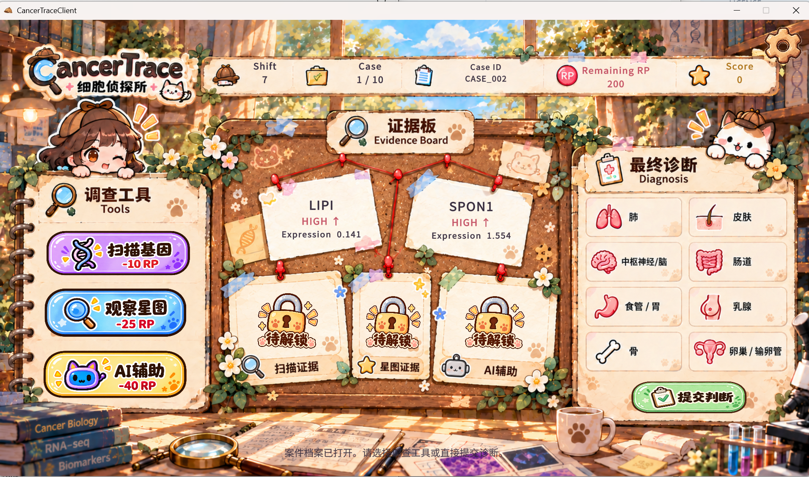
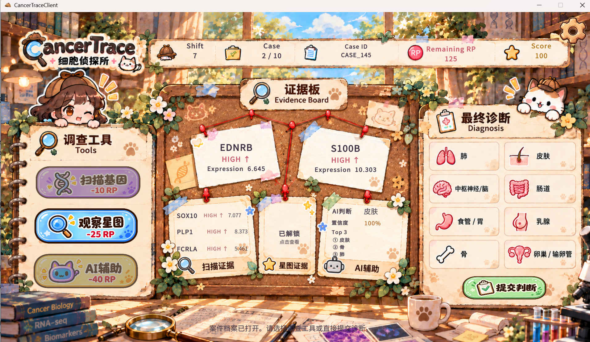
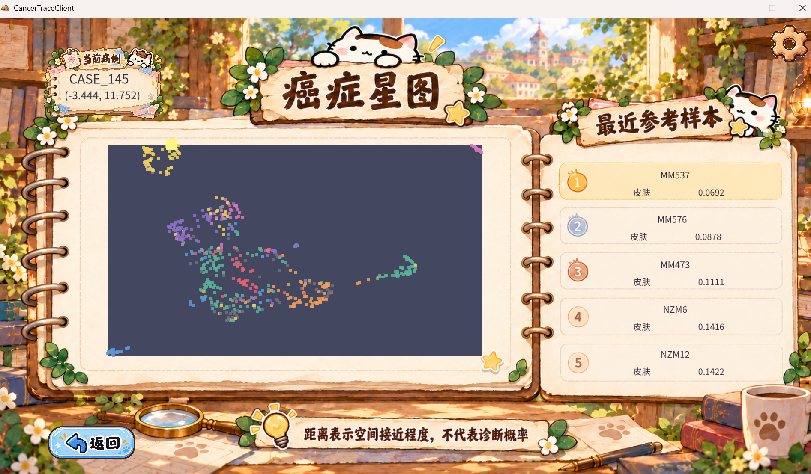
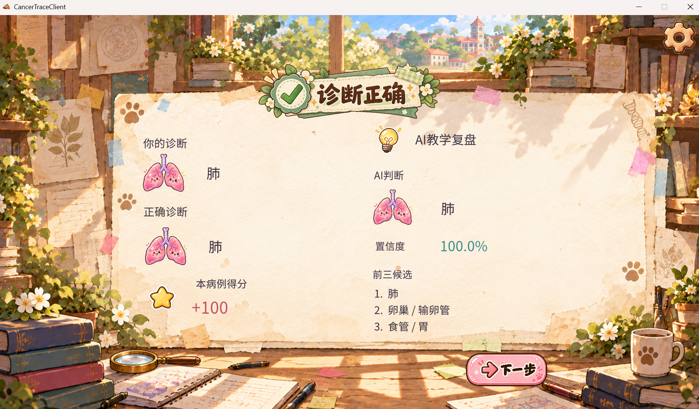
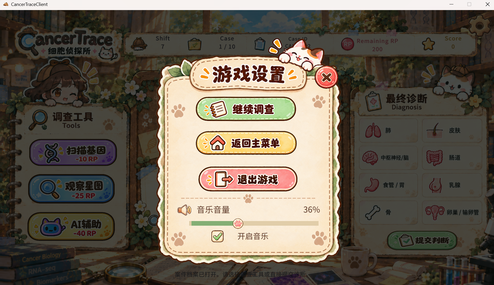
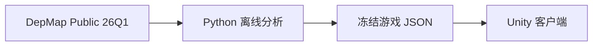

<h1 align="center">CancerTrace 细胞侦探所</h1>

  <strong>基于癌细胞系转录组数据的中文科研调查游戏</strong> 
  <em>读懂基因线索，循着星图追查病例。</em>

  
  
  
  

  <a href="#screenshots">游戏截图</a> ·
  <a href="#gameplay">核心玩法</a> ·
  <a href="#download">Windows 下载</a> ·
  <a href="#developer-guide">开发指南</a>

## 🔎 项目简介 (Introduction)

CancerTrace 把癌细胞系的基因表达数据带进手账风格的侦探游戏。你将扮演调查员，用有限的科研点（RP）获取基因线索、比较癌症星图上的参考样本，再结合证据板，在八类选项中提交判断。

> 本项目仅用于科普与教学演示，不用于真实疾病诊断或临床医疗决策。

## 📸 游戏截图 (Game Screenshots)

   
  <strong>主菜单</strong> · 开始或继续调查，也可以进入教程引导。

| 病例调查 · 初始线索 | 病例调查 · 解锁证据 |
| :---: | :---: |
|  |  |
| 先读证据板，再决定如何分配 RP。 | 在证据板上对照扫描结果、星图入口和 AI 提示。 |
| **癌症星图** | **病例结果** |
|  |  |
| 查看样本分布与最近的参考样本。 | 对照自己的判断、正确答案与 AI 教学复盘。 |

展开查看游戏设置截图

 

  

## 🧬 核心玩法 (Core Gameplay)

1. **完成教程。** 首次正式调查前需完成教程。教程进度独立保存。
2. **调查病例。** 每个 Shift（调查班次）包含 10 个病例，共享 RP。阅读初始线索，按需使用基因扫描（Gene Scan）、癌症星图（Cancer Galaxy）和 AI 辅助（AI Assistant），再到证据板汇总线索。异常病例的部分信息受保护。
3. **提交判断并复盘。** 从八类诊断选项中选择一类，查看病例结果。随后继续下一个病例，或在本班次结束时查看汇总。

### 五个正式场景

| 场景 | 玩家在这里做什么 |
| --- | --- |
| 主菜单 `MainMenu` | 开始调查、继续调查或进入教程。 |
| 病例调查 `CaseAnalysis` | 使用调查工具、查看证据板并提交判断。 |
| 癌症星图 `CancerGalaxy` | 查看当前病例与参考样本在二维降维空间中的分布。坐标由基因表达数据经 PCA 和 UMAP 降维得到，图上间距不能用于衡量真实生物学距离。 |
| 病例结果 `ResultSummary` | 查看单个病例的正确答案、得分和 AI 教学复盘。 |
| 班次汇总 `ShiftSummary` | 查看整个 Shift 的调查结果。 |

教程复用现有场景，并使用独立的教程状态。[Unity 场景说明](unity/CancerTraceClient/Assets/Scenes/README.md)

### 设置与存档

按 **Esc** 或点击右上角齿轮可打开设置，调整 BGM、返回主菜单或退出游戏。出现“进度尚未保存”时，点击“重试保存”，并在退出前确认保存成功，以免丢失当前进度。

Windows 本地存档目录为 `%USERPROFILE%/AppData/LocalLow/DefaultCompany/CancerTraceClient/`。

| 内容 | 保存位置 |
| --- | --- |
| 正式调查进度 | `cancertrace_save_v1.json` |
| 教程进度 | `cancertrace_tutorial_progress_v1.json` |
| BGM 设置 | Unity PlayerPrefs |

## 🏗️ 技术架构 (Technical Architecture)

Python 分析脚本将病例、星图等资料导出为 JSON，分类模型的预测随数据一并导出。冻结数据保存在 `results/game_data/`，Unity 运行时从正式工程的 `Assets/StreamingAssets/GameData/` 读取本地副本。[Python 分析说明](python/README.md) · [冻结游戏数据说明](results/game_data/README.md)

## 🛠️ 技术栈 (Tech Stack)

| 模块 | 技术 |
| --- | --- |
| 游戏客户端 | Unity 2021.3.45f2c1、C#、UGUI、TextMesh Pro |
| 游戏数据读取 | JSON、Newtonsoft.Json |
| 分析与导出 | Python、pandas、scikit-learn、UMAP |
| Windows 构建 | x64 / Mono |

## 📦 下载与安装 (Download & Installation)

**目标环境**为 64 位 Windows 10/11、支持 DirectX 11 的显卡、键盘和鼠标。推荐使用 1920×1080。最低 CPU、内存和显存需求尚未实机测定。

1. 打开 [GitHub Release（course-final）](https://github.com/xixixixi-haha/CancerTrace/releases/tag/course-final)，在 **Assets** 中下载 `CancerTrace-Windows-PC.zip`。
2. 将 ZIP 完整解压到一个文件夹，保持 `CancerTraceClient.exe`、`CancerTraceClient_Data/` 与同级运行依赖的相对位置。
3. 在解压后的文件夹中双击 `CancerTraceClient.exe` 启动游戏。

> **Windows SmartScreen 安全提示**
>
> 若出现“Windows 已保护你的电脑”，请先确认 ZIP 来自上方项目的 GitHub Release。在 ZIP 所在目录打开 PowerShell，运行 `Get-FileHash .\CancerTrace-Windows-PC.zip -Algorithm SHA256`，将结果与 **Assets** 中列出的 SHA-256 比对。确认来源与校验值、且设备策略允许时，可在提示窗口选择“更多信息” → “仍要运行”。来源无法确认、校验不符或安全软件明确拦截时，请停止运行。[Microsoft SmartScreen 说明](https://learn.microsoft.com/windows/apps/package-and-deploy/smartscreen-reputation)

## 🧰 开发者指南 (Developer Guide)

1. 在 Unity Hub 中使用 **Unity 2021.3.45f2c1** 打开 `unity/CancerTraceClient/`。
2. 加载 `Assets/Scenes/MainMenu.unity` 并进入 Play Mode。[开发环境与测试范围](unity/README.md)

| 路径 | 用途 |
| --- | --- |
| `unity/CancerTraceClient/` | 正式 Unity 工程，包含 `Assets/`、`Packages/` 和 `ProjectSettings/`。 |
| `unity/Docs/` | 游戏设计、系统规格和客户端开发资料。 |
| `data/`、`python/` | 数据来源与 Python 分析、导出流程。依赖见 [requirements.txt](requirements.txt)。 |
| `results/game_data/` | 冻结游戏数据，运行副本位于正式工程的 `Assets/StreamingAssets/GameData/`。 |
| `docs/` | 项目文档索引、Phase 4A 历史验收记录及 README 截图。 |
| `unity/CancerTraceClient_backup/` | 历史工程副本。 |

## 📚 数据来源与素材致谢 (Data Sources & Credits)

| 内容 | 来源与授权说明 |
| --- | --- |
| 游戏数据 | 源自 **Broad Institute DepMap Public 26Q1**。版本证据、输入文件与引用见 [数据来源](data/README.md)，导出范围见 [冻结游戏数据说明](results/game_data/README.md)。 |
| 95 项游戏美术素材 | 据项目方确认，清单内素材均由 ChatGPT / OpenAI 图像生成功能生成。生成日期、提示词及适用授权条款未提供。素材排除在本项目 MIT 授权范围之外。[逐文件来源清单](unity/CancerTraceClient/Assets/Art/ASSET_PROVENANCE.md) |
| 背景音乐 | Kistol 创作的 **Forget Me Not**，使用循环版，采用 **CC0**。[仓库授权记录](unity/CancerTraceClient/Assets/Audio/BGM/SOURCE_LICENSE.md) |
| 字体 | 思源黑体 **Source Han Sans SC Regular** 及其 TMP 派生资源适用 **SIL OFL 1.1**。[思源黑体许可证](unity/Docs/Licenses/SourceHanSans_LICENSE.txt) · [Liberation Sans 许可证](unity/CancerTraceClient/Assets/TextMesh%20Pro/Fonts/LiberationSans%20-%20OFL.txt) |
| 软件依赖 | Unity、TextMesh Pro、Newtonsoft.Json 等依赖遵循各自的许可条款。[第三方声明](THIRD_PARTY_NOTICES.md) |

## 📄 授权范围 (License)

**MIT 仅适用于 `LICENSE-SCOPE.md` 逐一列出的 58 个 CancerTrace 原创源代码文件**，包括 9 个 Python 文件、14 个 Unity C# 编辑器工具和 35 个 Unity C# 客户端脚本。

美术、音乐、字体、外部数据集、游戏数据、Unity 与第三方依赖、其他第三方素材，以及清单之外的文件（含文档、截图和构建产物）均在该 MIT 授权范围之外。第三方内容依其原有条款使用。

[MIT 许可证](LICENSE) · [授权文件清单与排除项](LICENSE-SCOPE.md) · [第三方声明](THIRD_PARTY_NOTICES.md)
